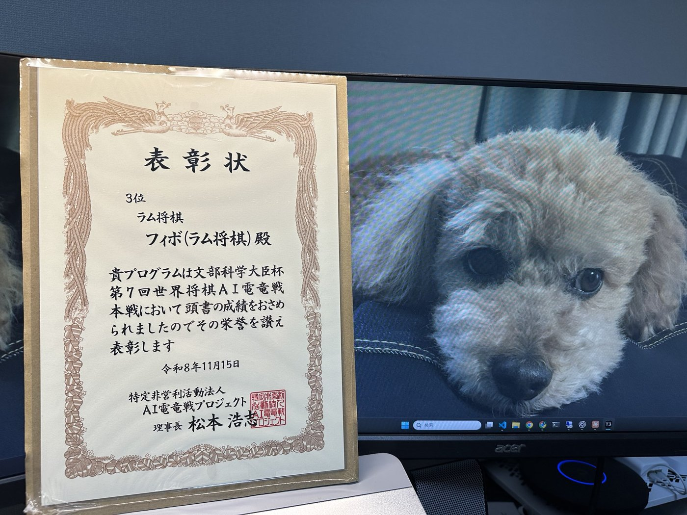
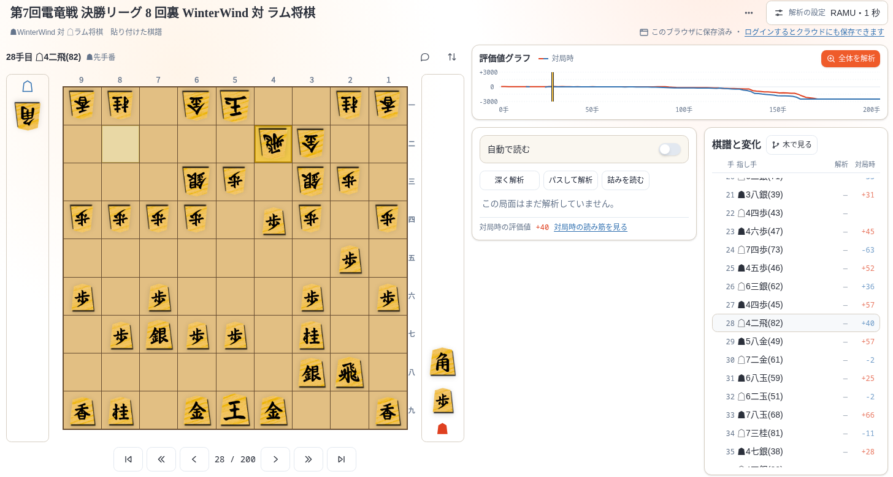
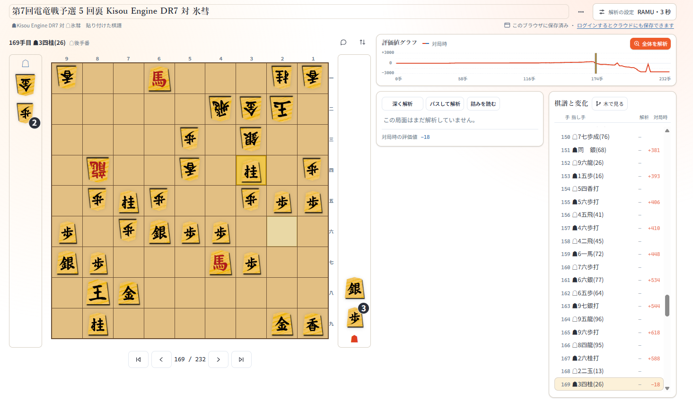
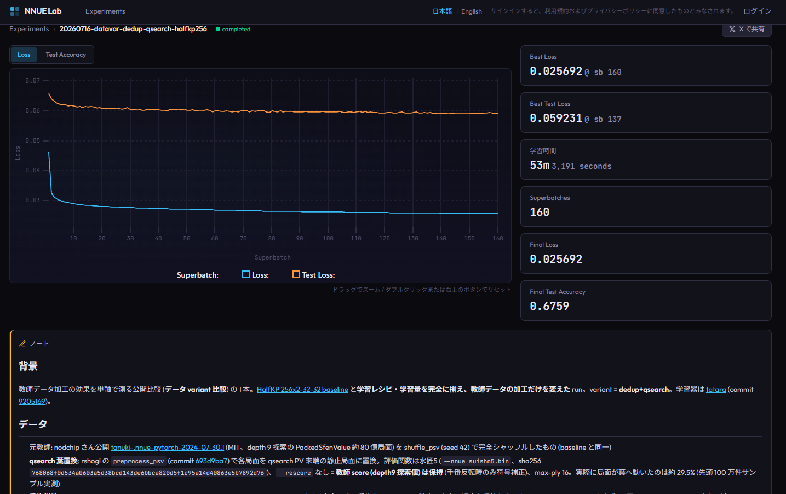
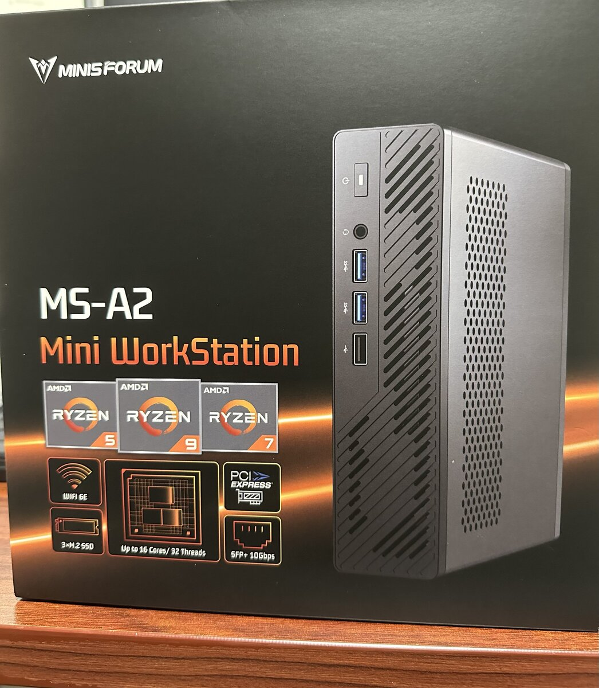

ラム将棋は第7回電竜戦の決勝リーグで **10勝8敗、3位** でした！
運営の方々、対局していただいた方々、ありがとうございました！

大会で使った評価関数と、大会の探索パラメータを組み込んだエンジンを BOOTH で販売しています（詳しくは記事の後半の「[評価関数とエンジンの販売](#評価関数とエンジンの販売)」）。

## 結果

| 棋戦                | 形式                         | 成績          | 先手番 | 後手番    | 順位                    |
| ------------------- | ---------------------------- | ------------- | ------ | --------- | ----------------------- |
| 予選（1日目）       | スイス式 7回戦 × 先後 = 14局 | **8勝5敗1分** | 6勝1敗 | 2勝4敗1分 | **8位**（決勝リーグへ） |
| 決勝リーグ（2日目） | 総当たり 9回戦 × 先後 = 18局 | **10勝8敗**   | 8勝1敗 | 2勝7敗    | **3位**                 |

定跡の準備が万全ではなく、定跡の出口で先手が大きくリードした状態から始まる対局が少なかったので、難しい対局が多かった印象です。
後手番は角換わりの有名定跡（出口で先手必勝系になる）に突っ込んでおり、有識者からすると見応えが無いものも多かったです。
ただ、後手番での勝ちもいくらか残せていて地力の強さが出せたかなと思います。
予選は最後の4連勝でギリギリ決勝リーグに上がり、決勝リーグも終盤に後手番で勝って順位が一気に上がるなど、ずっとハラハラする2日間でした。

## 印象に残った対局

### 決勝リーグ8回戦 対 WinterWind

ラム将棋が後手で、8手目 △７七角成 の角換わりから 28手目 △４二飛 と四間飛車を指しました。
将棋AIでは振り飛車は評価が低い（飛車を振るだけで評価値が100とか200とか下がる）とされているので、比較的珍しい棋譜になったのかなと思います。

[ラム将棋で棋譜を見る](https://ramu-shogi.sh11235.com/studies/93e9bdba-c080-411c-85d7-a0b2f255e7a6)

この対局は、電竜戦の中継で[齊藤優希四段](https://www.shogi.or.jp/player/yuuki_saito)（日本将棋連盟 プロ棋士）が解説を、[真澤千星さん](https://x.com/chisei_mazawa)（将棋アイドル）が聞き手を担当されていました。

[中継の動画（この対局の解説から再生）](https://youtu.be/aBJ-mjadL94?t=14133)

自分は将棋エアプなので、AI の指し手の意味をちゃんと理解して解説されること自体がものすごいことだと感じています。
△４二飛 は（読みで選んだ手ではありますが）4筋を押さえられても飛車が下に回れば受かる、という受けの意味もあるのかもしれない、という解説で、普段は将棋盤よりもターミナルとソースコードばかり見ている自分には分からない話だったなぁと思いました。

https://x.com/ramu_shogi/status/2121848186151330042

AIの読み筋から解説するAIは作れますが、人間の感覚からくる言語化はやはりプロや将棋に詳しい方でないと難しいもので、人間的な解説の方が納得しやすいのかもしれないなと思いました。
解説いただき、ありがとうございました！

### 決勝リーグ3回戦 対 氷彗

ラム将棋が先手で、304手で宣言勝ちした対局です。
今回のラム将棋の評価関数は、入玉の形について少し工夫をしていたので、それが効いたのか宣言勝ちまでうまく運べました（大会用のマシンスペックなら、探索で正しい答えにたどり着けただけという可能性もありますが）。
この対局を、[将棋情報 そら](https://www.youtube.com/@shogi-Joho)のそらさんが動画で解説してくださいました。
そらさんは、私が将棋を知り、将棋AIを作るきっかけになった方で、角換わり基本図などはこの方の動画で覚えました。
今回の電竜戦のスポンサーもされています。いつもありがとうございます。

https://www.youtube.com/watch?v=EA7Z-ioQzxQ

### 予選5回戦 Kisou Engine DR7 対 氷彗

我らがスーパースターである氷彗が後手番で、先手の評価値が大きく出ているところから大逆転しました。
これにはしびれた方も多いのではないでしょうか。
おそらく氷彗はもう少し前から逆転が見えていたのだと思いますが、ラム将棋である程度読ませたところ、実戦で ▲２六桂打 と指した167手目に ▲２四歩 としていれば +17 で互角程度だったようです。

[ラム将棋で棋譜を見る](https://ramu-shogi.sh11235.com/studies/442aa6ec-21d1-4431-bd37-622b7ed7cb6f)

## 大会までの準備

大会に出したアピール文書です。
https://drive.google.com/file/d/1hRw32V3IDN7nwsJWGUK9ucpG51etROgD/view?usp=drive_open

探索部、学習器、CSA通信部、評価ツールなど全て自作（Rust が中心で、学習器の GPU の部分は CUDA C++）で臨みました。
NNUE系の公開されているエンジンの中では、やねうら王系以外で一番上位に入れたのではないかと思います。
エンジンは [rshogi](https://github.com/SH11235/rshogi)（GPL-3.0-or-later）、学習器は [tatara](https://github.com/SH11235/tatara)（MIT）で、どちらも公開しています。
評価関数は LayerStacks 系（HalfKA_hm、2304-16-64）で、今回は進行度の重みでバケットを分けました（進行度重みによるバケット分割は [nodchip さんの考案](https://nodchip.hatenablog.com/entry/2026/02/04/000000)）。
FT（入力層の幅。2304-16-64 の 2304）は 1536 を基準に実験を続けていましたが、大会直前に 2 倍の 3072 と中間の 2304 を学習し、探索パラメータの調整（SPSA）と対局での評価が先に間に合った 2304 を採用しました。

大会の少し前に開発用で買ったPCが壊れて実験が進まなくなり、参加するかも悩んだところでしたが何とか準備して参加しました。
PCが壊れた頃は古いPCで犬を増やす（[ラム将棋アプリ](https://ramu-shogi.sh11235.com/play)に評価関数の選択肢を足す）という事をやっていました。

https://x.com/ramu_shogi/status/2113616083903226208

### 将棋エンジン + ツール群 rshogi

LLMはすぐに使い捨てのようなPythonコードを書きますが、運用で使うものはブラッシュアップし、性能を出せるようにRustのツールとして書き直しました。
学習データの生成・加工、自己対局のほか、運用で必要になった細かいツールが全部あります。
https://github.com/SH11235/rshogi/tree/main/crates/tools

### 学習器 tatara

将棋の NNUE の学習には、最初はチェス用の [bullet](https://github.com/jw1912/bullet) を将棋向けに fork した [bullet-shogi](https://github.com/SH11235/bullet-shogi) を使っていました。
nnue-pytorch では、HalfKX系のアーキテクチャを試していた当時でも1つの学習に数日かかるなどしてなかなか捗らなかったため、高速に学習できるらしいチェスの bullet を将棋用にカスタマイズして、満足できる時間で実験できるようになりました。
その後、2026年5月に cuda-oxide がNVIDIAから発表されて、CUDAをRustで書ける（雑な説明）ということなので、LLMもあるし自作学習器にチャレンジしようと作り始めたのが [tatara](https://github.com/SH11235/tatara) でした。
cuda-oxide は今はある程度安定化して [cuda-rust](https://github.com/NVIDIA/cuda-rust) のリポジトリの1要素になったようです。
さらに、backend は CUDA C++ で書いた方が性能が出るので、tatara での実験が安定してきたところで CUDA C++ で書き直して高速化し、cuda-oxide はデフォルトでは使わなくなりました。
nnue-pytorch と比べて10倍以上は高速化したはずなので（halfkp_256x2-32-32 の学習で比べた値）、最近主流になった LayerStacks 系のアーキテクチャも多くの人が試しやすくなったかと思います。
大会の[参加者一覧](https://denryu-sen.jp/denryusen/dr7_prd/members.html)の「使っているライブラリ」の欄を見ると何チームかが tatara を使っていて、決勝リーグの 10 チームでは、ラム将棋を含めて **5 チーム**（お紅さん狸・水匠・NagiNagisa・Cyfamate・ラム将棋）でした。
これを作り上げるためにハードや電気代を溶かしてきましたが、今後のNNUE系開発者が節約できる電気代・時間の価値を考えればきっとプラスになっていると信じています。

公開されている教師データ（nodchipさんなど）を、公開されている DL水匠（たややんさん）で評価値をつけなおし、LayerStacks 系で学習するだけで去年の氷彗に（ある程度定跡を持った先手番なら）太刀打ちできるくらいには強いと思うので、tataraの存在でNNUE系のレートは底上げされたに違いないと思っています。少なくともこれだけの簡単なレシピでも今のやねうら王（Finny Tables などが入ったもの）ではNPSが十分に出ますし、従来のHalfKX系アーキテクチャには大きく勝ち越せるものになると思います。
先手とはいえ今の氷彗にちゃんと勝ち切るにはもう一押しくらいの工夫は必要かもしれませんが、少なくともNNUE系に関しては手元の計算資源にもよりますが、数日から1週間程度でここまで追いつける環境が出来ました。

### nnue-lab

WCSC36で奏乗チームのお手伝いをしているときに実験管理ツールを作っていました。
今では公開しているので誰でも利用可能です。
https://nnue-lab.sh11235.com/
bullet-shogi（fork の BulletOu にも引き継がれているはず）や tatara で学習すると experiment.json というメタデータのファイルが出力されるので、これをアップロードすると過去の実験を誰でも再現できる形で可視化できます。
例えば、教師データの加工（qsearch 処理と、その後の重複削除）だけを変えて halfkp_256x2-32-32 を学習した実験は、次のように見られます。

[この実験のページ](https://nnue-lab.sh11235.com/t/sh11235/experiments/01JTNNB0IJ7C1708D2C94C6902)

いわゆるJSON色付け係の簡単なお仕事ですね（公開するにあたってBackendをちゃんと整理したりの手間はありましたが）。
以下の記事である程度触れていますが、MCP に対応したので、LLM に「実験が終わったらアップロードしておいて」「過去の実験データを見て次の実験計画を立てて」と頼めます。
https://sh11235.com/articles/nnue-lab-developer-api/
個人だったら自分のハードに記録があれば十分ですが、図が見られると人間的に嬉しいのと、メモを書けたりチームで開発したりで捗るのかなと思います。

## NNUE 系と DL 系について

https://x.com/ramu_shogi/status/2121843914638594091

### DL 系は冬の時代と言われている

https://x.com/komafont/status/2121608375972893037

NNUE系と比べると、公開データから到達できるモデルの棋力がまだ低いのだろうと思います（この辺はまだ自分で検証していないので詳しくないです）。
さらに DL 系は必要な計算資源のコストが高く NNUE 系より簡単に実験の試行回数を稼ぐことが出来ません。
この辺りは我らがやねうら王さんがふかうら王の貴重なデータを配布されているので、fanbox に加入するのが現時点で最速のスターターキットですかね？

https://yaneurao.fanbox.cc/plans/480298

DL系の将来性が無いわけではなく、相対的に安価で簡単に強いものを作れるのがNNUE系で、最近のLLMの進化でそれがより顕著になった（一助として tatara の存在もある・・・？）のかなと思います。

## 大会全体の数字

公式の全棋譜（**836局**）から集計した、大会全体の数字です。

### 先手と後手の勝ち数

公式の全棋譜の、棋戦ごとの先手・後手の勝ち数と千日手です（結果の無い不成立の 4局を除く。この節は体験会も含みます）。持ち時間は先手 3 分・後手 10 分（どちらも 1 手 2 秒加算）です。

| 棋戦       | 局数 | 先手の勝ち     | 後手の勝ち     | 千日手        |
| ---------- | ---- | -------------- | -------------- | ------------- |
| 予選       | 321  | 181勝（56.4%） | 126勝（39.3%） | 14局（4.4%）  |
| 決勝リーグ | 90   | 66勝（73.3%）  | 14勝（15.6%）  | 10局（11.1%） |
| B級        | 286  | 165勝（57.7%） | 112勝（39.2%） | 9局（3.1%）   |
| 体験会     | 135  | 67勝（49.6%）  | 67勝（49.6%）  | 1局（0.7%）   |
| 全体       | 832  | 479勝（57.6%） | 319勝（38.3%） | 34局（4.1%）  |

マシントラブルの局（[後の節](#マシントラブル)で数えています。後の節は体験会を除いた数です）を直した数字も出しました。直し方は次のとおりです。

- 時間切れ・接続切れの局（体験会を含めて 36局）は、終わった時点の双方の最後の評価値（先手から見た値）の符号が同じで、どちらも絶対値 200 以上なら、評価値の良い側の勝ちにする。評価値を出さない側がいる局は、出している側の値だけで決める。決まらない局は除く
- 序盤の評価値の異常の 3局と不成立の 4局は除く

勝敗が決まったのは 36局のうち **17局** で、うち **8局** は元の結果と勝ちの側が入れ替わりました（8局とも後手の勝ちから先手の勝ちへ）。

| 棋戦       | 局数 | 先手の勝ち     | 後手の勝ち     | 千日手        |
| ---------- | ---- | -------------- | -------------- | ------------- |
| 予選       | 317  | 184勝（58.0%） | 119勝（37.5%） | 14局（4.4%）  |
| 決勝リーグ | 86   | 65勝（75.6%）  | 11勝（12.8%）  | 10局（11.6%） |
| B級        | 284  | 164勝（57.7%） | 111勝（39.1%） | 9局（3.2%）   |
| 体験会     | 123  | 62勝（50.4%）  | 60勝（48.8%）  | 1局（0.8%）   |
| 全体       | 810  | 475勝（58.6%） | 301勝（37.2%） | 34局（4.2%）  |

komafontさんが2020年からのグラフも作成されていました。

https://x.com/komafont/status/2122101644603310226

### 決勝リーグのチームごとの先手番と後手番

決勝リーグの 10 チームの、先手番と後手番ごとの成績です。並びは[公式の順位表](https://denryu-sen.jp/denryusen/dr7_prd/match_live.php?gamename=dr7prdf1)の順で、「公式の勝ち数」の列は千日手を先手 0.4勝・後手 0.6勝として数えた値です。

| 順位 | チーム                | 公式の勝ち数 | 成績       | 先手番    | 後手番    |
| ---- | --------------------- | ------------ | ---------- | --------- | --------- |
| 1位  | 水匠                  | 12.2勝       | 11勝5敗2分 | 8勝1敗    | 3勝4敗2分 |
| 2位  | Nnuenagon             | 10.4勝       | 9勝6敗3分  | 7勝0敗2分 | 2勝6敗1分 |
| 3位  | ラム将棋              | 10勝         | 10勝8敗    | 8勝1敗    | 2勝7敗    |
| 4位  | やねうら王 with GTNET | 9.6勝        | 9勝8敗1分  | 8勝1敗    | 1勝7敗1分 |
| 5位  | NagiNagisa            | 9.4勝        | 8勝7敗3分  | 7勝0敗2分 | 1勝7敗1分 |
| 6位  | Kisou Engine DR7      | 8.6勝        | 8勝9敗1分  | 6勝3敗    | 2勝6敗1分 |
| 7位  | 氷彗                  | 8.4勝        | 8勝9敗1分  | 8勝0敗1分 | 0勝9敗    |
| 8位  | WinterWind            | 8勝          | 7勝9敗2分  | 6勝2敗1分 | 1勝7敗1分 |
| 9位  | Cyfamate              | 7.2勝        | 6勝9敗3分  | 4勝2敗3分 | 2勝7敗    |
| 10位 | お紅さん狸            | 6.2勝        | 4勝10敗4分 | 4勝4敗1分 | 0勝6敗3分 |

先手必勝の雰囲気はより強まっており、先手は必勝なので後手番でいくら勝てるのかというだけの世界に近づいている感じがします。
今の評価関数で十分先手必勝な棋力なのでしょうか・・・？（そんなわけはない！ともっともっと強い評価関数を作って、定跡無しでも勝ち切れるものを目指したいとは思います）。
どのチームも先手よりは後手の定跡が課題で、大会ごとにいかに相手を未知の進行に連れていけるかという定跡のメタゲームになっていそうです。水匠の後手番戦術がまさにこれだったと思われます。
ただ、評価値的には少し不利なことを分かって誘導するしかないと思うので、相手とのレーティング差がはっきりしていないと後手で勝つことは出来ないでしょうね。
有望そうな進行は既知になれば定跡で対策するだけのことなので、後手番で出来る事はどんどんなくなっていくばかりですね・・・。

水匠は先手番を事故で1局落としながらも、2位と差をつけて優勝しました。流石の実力でした。おめでとうございます。
あの氷彗が、後手番だと勝てないというのも結構な衝撃でした。

### 定跡を抜けた手と評価値

決勝リーグの各対局者が、先手・後手それぞれで定跡を抜けた手と、そのときの評価値です。
定跡を抜けた手は、その対局者が初めて 2 秒以上考えた自分の手としました（公式の棋譜の消費時間は秒単位で、定跡の手は 0 秒です）。
相手の手を先読みしていて当たったときも 0 秒になるので、これは目安で、実際に定跡を抜けた手より後の手になることがあります。
序盤に評価値がおかしくなった 3 局（[マシントラブル](#マシントラブル)の節）は除き、表の括弧の局数は評価値のあった局の数です。
評価値は、その手で対局者のエンジン自身が出した値（先手から見た値）で、エンジンごとに尺度は揃っていません。
相手の方が長く定跡を持っていると、自分が抜けた後も相手の定跡の手順が続くので、先手・後手の遅い方が抜けた手を「両者が抜けた手」として、その手以降に自分のエンジンが初めて出した評価値も並べました。
対局ごとの抜けた手と、両者が抜けた手の評価値（遅く抜けた側のエンジンの値）は付録に載せています。

先手番:

| 対局者                | 抜けた手（中央値） | 抜けた手の評価値 平均 / 中央値 | 両者が抜けた手（中央値） | 両者が抜けた後の自分の評価値 平均 / 中央値 |
| --------------------- | ------------------ | ------------------------------ | ------------------------ | ------------------------------------------ |
| Cyfamate              | 49手目             | +97 / +101（9局）              | 49手目                   | +101 / +101（9局）                         |
| Kisou Engine DR7      | 37手目             | +179 / +216（9局）             | 55手目                   | +82 / +216（9局）                          |
| NagiNagisa            | 33手目             | +98 / +75（9局）               | 33手目                   | +147 / +74（9局）                          |
| Nnuenagon             | 70手目             | +324 / +173（8局）             | 70手目                   | +324 / +173（8局）                         |
| WinterWind            | 31手目             | +148 / +66（9局）              | 31手目                   | +154 / +66（9局）                          |
| お紅さん狸            | 37手目             | +94 / +93.5（8局）             | 37手目                   | +96 / +110（8局）                          |
| やねうら王 with GTNET | 49手目             | +133 / +132（8局）             | 58.5手目                 | +88 / +123（8局）                          |
| ラム将棋              | 31手目             | +115 / +102（8局）             | 32手目                   | +137 / +123.5（8局）                       |
| 水匠                  | 25手目             | +87 / +106（8局）              | 33手目                   | +165 / +129（8局）                         |
| 氷彗                  | 21手目             | +63 / +75（9局）※              | 35手目                   | +74 / +80（9局）※                          |

後手番:

| 対局者                | 抜けた手（中央値） | 抜けた手の評価値 平均 / 中央値 | 両者が抜けた手（中央値） | 両者が抜けた後の自分の評価値 平均 / 中央値 |
| --------------------- | ------------------ | ------------------------------ | ------------------------ | ------------------------------------------ |
| Cyfamate              | 16手目             | +165 / +175（5局）             | 25手目                   | +168 / +117（5局）                         |
| Kisou Engine DR7      | 28手目             | +45 / +43（9局）               | 33手目                   | +26 / +53（9局）                           |
| NagiNagisa            | 26手目             | +47 / +38.5（8局）             | 35手目                   | +182 / +60（9局）                          |
| Nnuenagon             | 50手目             | +83 / +87（9局）               | 55手目                   | +197 / +130（9局）                         |
| WinterWind            | 16手目             | +93 / +106（9局）              | 23手目                   | +83 / +90（9局）                           |
| お紅さん狸            | 36手目             | +73 / +56（9局）               | 40手目                   | +73 / +55（9局）                           |
| やねうら王 with GTNET | 28手目             | +80 / +85（9局）               | 30手目                   | +53 / +17（9局）                           |
| ラム将棋              | 46手目             | +140 / +96（9局）              | 60手目                   | +232 / +291（9局）                         |
| 水匠                  | 20手目             | -30 / +74（9局）               | 43手目                   | -31 / +63（8局）                           |
| 氷彗                  | 22手目             | +40 / +30（9局）※              | 37手目                   | +105 / +101（9局）※                        |

- ※ 氷彗は評価値を送っていないので、氷彗の値は、氷彗が定跡を抜けた手を指す前の局面をラム将棋（大会の評価関数）で読み直した値です（1 局面 1 億ノード、先手から見た値）。
- 氷彗の「両者が抜けた後の自分の評価値」も同じく、両者が抜けた手以降に氷彗が初めて指した手の前の局面をラム将棋で読み直した値です。

Nnuenagon は先手で抜けた手の中央値が 70手目で、研究の深さが数字としてよくわかる結果でした。
ラム将棋は後手番の定跡が長いように見えますが、定跡を抜けた後の評価値を見ると後手の定跡の悪さが目立っています（突貫工事でちゃんと掘れなかった反省があります）。
後手番の方が持ち時間もあるので、避けたい線だけ切るようにしてあとは当日の本番スペックマシンでの読みに任せた方がいくらかマシだった可能性は高そうです。
水匠の後手の平均（-30）が目を引きますが、これは対 Kisou Engine DR7 の 1 局（76手目に -867 で定跡を抜け、そのまま後手の水匠の勝ち）に引っ張られた値で、残りの 8 局（+11〜+106、平均 約 +74）はほかのチームと同じくらいでした。
そもそも同じ評価関数で全部の評価値を付けないと比較するのはナンセンスではありますが、ある程度参考になるデータが見られたと思います。

### 手数と終局のしかた

棋戦ごとの手数と、宣言勝ち・千日手の数です。

| 棋戦                | 局数 | 手数の中央値 | 250手以上         | 宣言勝ち          | 千日手            |
| ------------------- | ---- | ------------ | ----------------- | ----------------- | ----------------- |
| 予選（11/14）       | 321  | 137手        | 26局（8.1%）      | 12局（3.7%）      | 14局（4.4%）      |
| 決勝リーグ（11/15） | 90   | **200手**    | **20局（22.2%）** | **10局（11.1%）** | **10局（11.1%）** |
| B級（11/15）        | 288  | 137手        | 15局（5.2%）      | 17局（5.9%）      | 9局（3.1%）       |

ラム将棋の対局は次のとおりです。

| 棋戦       | 局数 | 手数の中央値 | 最長  | 250手以上 | 宣言勝ち                            | 千日手 |
| ---------- | ---- | ------------ | ----- | --------- | ----------------------------------- | ------ |
| 予選       | 14   | 166手        | 220手 | 0局       | 0局                                 | 1局    |
| 決勝リーグ | 18   | 203手        | 317手 | 4局       | 3局（ラム将棋の勝ち 2局・負け 1局） | 0局    |

決勝リーグの最長は **429手**（お紅さん狸 対 Nnuenagon）、予選の最長は **393手**（宣言勝ち）でした。

### 入玉の対局

決勝リーグではよく入玉系の局面を見る印象があったので集計したところ、実際に予選よりも宣言勝ちになっている対局の割合が高かったです。
ラム将棋は先手番で 2回宣言勝ちし（対 氷彗・対 NagiNagisa）、対 Nnuenagon では後手の Nnuenagon に宣言勝ちされました。
512手で引き分けになるルールが適用された対局は無かったようです。
大会に出るような仕上がった評価関数、大会用のハードでは入玉系になってもちゃんと詰み or 宣言勝ちに向かう力があるようです（決勝リーグの Nnuenagon 対 水匠 は、双方の玉が敵陣に入ったあと 373手で千日手になりました）。

ここでは「終局の時点で、どちらかの玉が敵陣（相手側の 3 段）にいる対局」を入玉の対局と数えると以下の数値になりました。

| 棋戦       | 局数 | 入玉の対局        | 双方の玉が敵陣にいた対局 |
| ---------- | ---- | ----------------- | ------------------------ |
| 予選       | 321  | 55局（17.1%）     | 15局（4.7%）             |
| 決勝リーグ | 90   | **25局（27.8%）** | **9局（10.0%）**         |
| B級        | 288  | 44局（15.3%）     | 11局（3.8%）             |

ラム将棋は、予選の 14局では **0局**、決勝リーグの 18局では **5局** でした。5局はどれもラム将棋が先手番で、うち 3局は宣言勝ちで終わりました（ラム将棋の宣言勝ちが 2局、相手の Nnuenagon の宣言勝ちが 1局）。

予選の対局も集計しました。「決勝のチーム」は決勝リーグに進んだ 10 チームです。

| 予選の対局の組                 | 局数 | 入玉の対局    |
| ------------------------------ | ---- | ------------- |
| 決勝のチームどうし             | 28   | 7局（25.0%）  |
| 決勝のチームとそれ以外のチーム | 84   | 17局（20.2%） |
| それ以外のチームどうし         | 209  | 31局（14.8%） |

予選でも、決勝のチームどうしの対局は入玉がやや多めでした（28局と少ないので、はっきりした差とまでは言えません）。

### マシントラブル

公式の全棋譜のうち、体験会を除いた **699局**（予選・決勝リーグ・B級）から、マシントラブルと思われる局を **23局（3.3%）** 抜き出しました。

| 分類               | 局数 | うち決勝リーグ | 補足                                                                                            |
| ------------------ | ---- | -------------- | ----------------------------------------------------------------------------------------------- |
| 時間切れ           | 15   | 2              | 1局は 6回の表、ラム将棋戦で 184手まで進んだところで Kisou が時間切れ                            |
| 接続切れ           | 5    | 1              |                                                                                                 |
| 序盤の評価値の異常 | 3    | 3              | Cyfamate が後手の局で、6〜10手目に評価値が先手から見て +1453・+1658・+1557 に跳ね、そのまま負け |

棋戦ごとの数です。

| 棋戦       | 局数 | マシントラブル   | 時間切れ | 接続切れ | 評価値の異常 |
| ---------- | ---- | ---------------- | -------- | -------- | ------------ |
| 予選       | 321  | 14局（4.4%）     | 11       | 3        | 0            |
| 決勝リーグ | 90   | 6局（6.7%）      | 2        | 1        | 3            |
| B級        | 288  | 3局（1.0%）      | 2        | 1        | 0            |
| 合計       | 699  | **23局（3.3%）** | 15       | 5        | 3            |

不調の側になった回数は、多い順に Dainagon 4局、Ari Shogi and フレンズ・Gateau Echiquier・dlshogi・Cyfamate が 3局ずつで、全部で **10 チーム** でした。

局ごとの一覧（チーム名・手数・中継の棋譜へのリンク）は、記事の最後の[付録](#付録-マシントラブルの-23局)に置きました。分類と「不調の側」は、棋譜の終わり方と評価値から抜き出したもので、各チームに原因を確かめたものではありません。

指し手がおかしくなる・時間切れ（ソフトが原因の場合もある）・ネットワーク切れなど、大会の進行を乱すトラブルは今回の大会でも **3.3%**（699局のうち 23局）起きていて、完璧な準備はなかなか難しいのかもしれません。参加者が実際にやっている準備のお作法のようなものが共有されると、防げるものもありそうです。
例えば私の設定ではAWS CLIの認証が12時間で切れるので、前日19:00にログインしてあとはLLMに任せればOKだと思っていたら翌日7:00には認証が切れるのでログインできずに詰みます（Chrome操作まで任せていいならaws sso login まで任せられますが）。

## 大会に関連する費用

大会機（AWS c8a.48xlarge、AMD EPYC 9R45 ×2・192 コア・メモリ 384 GiB、東京リージョン ap-northeast-1、オンデマンドで 1 時間 **$13.02336**）の料金は、起動と終了の時刻から計算して約 **$320** でした。

| 用途           | 時刻           | 時間           | 料金        |
| -------------- | -------------- | -------------- | ----------- |
| 11/13 の試し   | 17:42〜17:56   | 0.23 時間      | 約 $3       |
| 11/13 の体験会 | 20:47〜翌 0:17 | 3.50 時間      | 約 $46      |
| 1日目（11/14） | 8:17〜17:53    | 9.60 時間      | 約 $125     |
| 2日目（11/15） | 7:04〜18:19    | 11.25 時間     | 約 $147     |
| 計             |                | **24.58 時間** | **約 $320** |

大会後の[ポスト](https://x.com/ramu_shogi/status/2121910696455925963)より:

> vastaiで適当に借りればと思っていましたがリージョンが遠いと遅延があること、体験会で特に定跡が薄い自分は先手の持ち時間を早々に失う懸念もあってAWSの東京リージョンを使いました。

定跡がまともに作れておらず、先手番で持ち時間が尽きること（1手2秒の加算だけになると読みが浅くなって中盤逆転され得る）を気にしていました。
（同じスペックのものが取れるかは分からないですが）vast.aiなどで借りたらもっと安く済みます。ただ、事前の検証ではネットワーク遅延があり、マージンを持たせると、持ち時間が尽きて1手2秒の加算だけになったときに実質1秒程度しか思考にあてられません。借りる相手のネットワーク・ハードが不安定だった場合にもクリティカルな問題が起こるので、AWSで借りました。
この辺は NagiNagisa さんがやっていたように冗長構成を組めばよさそうです。

https://x.com/naginagisasub/status/2122179231522422854

あとはPCが壊れてしまって何もしないわけにもいかずということで vast.ai を使いまくっていました。
手元の弱い資源を占有しては本当に何もできなくなるという事で、本番候補のマシンを捕まえては計測したり評価に使ったりしていました。
大会が近くなると Threadripperの 9995WX（一番強いやつ）がなかなか安価で流れてこなくなり、7995WXを比較的よく捕まえていた覚えがあります。
このSPSA、SPRT一回で○○○○円か・・・！と震えながらLLMにvast.ai のCLIを操作させ、予算を渡してある程度のタスクを外に逃がしていました。

大会の少し前に、自宅でずっと回しておく CPU の計算機として MINISFORUM の MS-A2（Ryzen 9 9955HX、16 コア 32 スレッド、メモリ 32GB、SSD 2TB）を **258,399円**（税込）で買いました。

買った理由は次のとおりです。

- vast.ai に払い続けるよりは中期的に安く済む。買う前の試算では、vast.ai で同じくらいの速さの家庭用の機械を 24 時間借りると月 約 **1.9万円**、MS-A2 の電気代は月 約 **2,000円** で、ずっと回し続ければ約 **15か月**、半分の時間だけ回すなら約 **30か月** で元が取れる計算でした。大体 2 年で元が取れる見込みです。
- 自宅のネットワークにあるので、データの転送が比較的速く済む。
- vast.ai のように借りた機械が不安定なことがなく、予算の管理も要らない。
- 1 台くらいならずっと回す仕事を用意できる。
- AVX-512 に対応していて、そこそこ速い。
- デスクトップを足すよりはお手軽。同じ値段帯で Ryzen 9 9950X のデスクトップを組む案もありましたが、場所を取るのが気になりました。

## 評価関数とエンジンの販売

第7回電竜戦で使った評価関数と、大会の探索パラメータを組み込んだエンジンを、BOOTH で販売しています。

もっと強いAI、開発者ツール類を作っていくので応援いただけると嬉しいです！

| 商品                                                                                                                                                                                        | 価格    | 中身                                                                                                                                                                                              |
| ------------------------------------------------------------------------------------------------------------------------------------------------------------------------------------------- | ------- | ------------------------------------------------------------------------------------------------------------------------------------------------------------------------------------------------- |
| [第7回電竜戦「RAMU DR7」評価関数・エンジン一式](https://sh11235.booth.pm/items/9202483?utm_source=sh11235.com&utm_medium=blog&utm_campaign=denryusen7)                                      | 4,980円 | 大会で使った評価関数（FT 2304）そのままと、大会の探索パラメータを組み込んだエンジン                                                                                                               |
| [「RAMU DR7」評価関数 3 種セット（RAMU mini・RAMU・RAMU big / FT 1536・2304・3072）](https://sh11235.booth.pm/items/9207955?utm_source=sh11235.com&utm_medium=blog&utm_campaign=denryusen7) | 9,800円 | 大きさ違いの評価関数 3 つ（FT 1536・2304・3072）と、それぞれのエンジン。2304 は上と同じもの                                                                                                       |
| [将棋AI「COCO」評価関数・エンジン（無料）](https://sh11235.booth.pm/items/9207970?utm_source=sh11235.com&utm_medium=blog&utm_campaign=denryusen7)                                           | 無料    | 評価関数（halfkp_256x2-32-32）とエンジン。評価関数はやねうら王の NNUE 版でも FV_SCALE を 14 にして使えます。有料の 2 つと同じエンジンなので、お使いの PC でどの版が動くかを購入前に確かめられます |

- 評価関数を動かすエンジン（rshogi。Windows 64bit 版と Linux x86_64 版の、それぞれ AVX2 版・AVX-512 版・AVX-512 VNNI 版）を同梱しています。
- ShogiHome・将棋所・ShogiGUI など、USI エンジンを登録できる GUI にエンジンを登録するだけで使えます（Linux 版は glibc 2.34 以降。Ubuntu 22.04 以降などで動きます）。評価関数の読み込みに要る設定は同梱のファイルから自動で読みます。
- エンジン本体の rshogi は GPL-3.0 で[公開しています](https://github.com/SH11235/rshogi)。

## おわりに

（大会後に記事の大枠を書いたのに、そのまま実験に頭が回って記事を書く手が進みませんでした）
消化不良な実験がまだまだあり、大会を通して見えた課題も山積みです。
強くなるには必然的にDL系も必要なのでDL系もやる、NNUE系のモデルも強くする、探索部も何か考えてみる、ツール類ももっと速くもっと使いやすくする。
全部やるしかない。

対局評価は自分なりにやっている型が出来たのでまとまった記事にしようかなと思います。

## 付録: マシントラブルの 23局

「大会全体の数字」の章のマシントラブルの一覧です。分類と「不調の側」は、棋譜の終わり方と評価値から抜き出したもので、各チームに原因を確かめたものではありません。手数は公式の棋譜の値です。

**時間切れ（15局）**

- 【B級】4回裏 ▲Gateau Echiquier △雪風 -静-（60手、不調の側: Gateau Echiquier） [中継](https://denryu-sen.jp/denryusen/dr7_prd/dist/#/dr7prd+buoy_blackbid420_dr7prdb1-4-bottom_4_gateau_yukikaze-600-2F+gateau+yukikaze+20261115120042/4)
- 【B級】6回表 ▲Ari Shogi and フレンズ △Yorkie（150手、不調の側: Ari Shogi and フレンズ） [中継](https://denryu-sen.jp/denryusen/dr7_prd/dist/#/dr7prd+buoy_blackbid420_dr7prdb1-6-top_4_arishogi_yorkie-600-2F+arishogi+yorkie+20261115143035/4)
- 【予選】1回表 ▲Dainagon △桐一葉（56手、不調の側: Dainagon） [中継](https://denryu-sen.jp/denryusen/dr7_prd/dist/#/dr7prd+buoy_blackbid420_dr7prdy1-1-top_4_dainagon_kirihitoha-600-2F+dainagon+kirihitoha+20261114100040/4)
- 【予選】1回裏 ▲Gokaku △雪風 -静-（108手、不調の側: Gokaku） [中継](https://denryu-sen.jp/denryusen/dr7_prd/dist/#/dr7prd+buoy_blackbid420_dr7prdy1-1-bottom_4_gokaku_yukikaze-600-2F+gokaku+yukikaze+20261114103025/4)
- 【予選】1回裏 ▲桐一葉 △Dainagon（61手、不調の側: Dainagon） [中継](https://denryu-sen.jp/denryusen/dr7_prd/dist/#/dr7prd+buoy_blackbid420_dr7prdy1-1-bottom_4_kirihitoha_dainagon-600-2F+kirihitoha+dainagon+20261114103036/4)
- 【予選】2回表 ▲Dainagon △soyokaze2026（46手、不調の側: Dainagon） [中継](https://denryu-sen.jp/denryusen/dr7_prd/dist/#/dr7prd+buoy_blackbid420_dr7prdy1-2-top_4_dainagon_soyokaze-600-2F+dainagon+soyokaze+20261114110013/4)
- 【予選】2回裏 ▲dlshogi △桐一葉（330手、不調の側: dlshogi） [中継](https://denryu-sen.jp/denryusen/dr7_prd/dist/#/dr7prd+buoy_blackbid420_dr7prdy1-2-bottom_4_dlshogi_kirihitoha-600-2F+dlshogi+kirihitoha+20261114113040/4)
- 【予選】2回裏 ▲soyokaze2026 △Dainagon（45手、不調の側: Dainagon） [中継](https://denryu-sen.jp/denryusen/dr7_prd/dist/#/dr7prd+buoy_blackbid420_dr7prdy1-2-bottom_4_soyokaze_dainagon-600-2F+soyokaze+dainagon+20261114113017/4)
- 【予選】3回表 ▲dlshogi △水匠（172手、不調の側: dlshogi） [中継](https://denryu-sen.jp/denryusen/dr7_prd/dist/#/dr7prd+buoy_blackbid420_dr7prdy1-3-top_4_dlshogi_suishoo-600-2F+dlshogi+suishoo+20261114130101/4)
- 【予選】3回裏 ▲Tachyon △TMOQ（特大もっきゅ）（140手、不調の側: Tachyon） [中継](https://denryu-sen.jp/denryusen/dr7_prd/dist/#/dr7prd+buoy_blackbid420_dr7prdy1-3-bottom_4_tachyon_tmoq-600-2F+tachyon+tmoq+20261114133018/4)
- 【予選】4回裏 ▲ラム将棋 △Ari Shogi and フレンズ（129手、不調の側: Ari Shogi and フレンズ） [中継](https://denryu-sen.jp/denryusen/dr7_prd/dist/#/dr7prd+buoy_blackbid420_dr7prdy1-4-bottom_4_ramushogi_arishogi-600-2F+ramushogi+arishogi+20261114143025/4)
- 【予選】6回裏 ▲dlshogi △NagiNagisa（310手、不調の側: dlshogi） [中継](https://denryu-sen.jp/denryusen/dr7_prd/dist/#/dr7prd+buoy_blackbid420_dr7prdy1-6-bottom_4_dlshogi_naginagisa-600-2F+dlshogi+naginagisa+20261114163045/4)
- 【予選】7回表 ▲Ari Shogi and フレンズ △Kisou Engine DR7（172手、不調の側: Ari Shogi and フレンズ） [中継](https://denryu-sen.jp/denryusen/dr7_prd/dist/#/dr7prd+buoy_blackbid420_dr7prdy1-7-top_4_arishogi_kisou-600-2F+arishogi+kisou+20261114170041/4)
- 【決勝リーグ】5回表 ▲水匠 △Cyfamate（0手、不調の側: 水匠、0 手で時間切れ） [中継](https://denryu-sen.jp/denryusen/dr7_prd/dist/#/dr7prd+buoy_blackbid420_dr7prdf1-5-top_4_suishoo_cyfamate-600-2F+suishoo+cyfamate+20261115133014/4)
- 【決勝リーグ】6回表 ▲Kisou Engine DR7 △ラム将棋（184手、不調の側: Kisou Engine DR7） [中継](https://denryu-sen.jp/denryusen/dr7_prd/dist/#/dr7prd+buoy_blackbid420_dr7prdf1-6-top_4_kisou_ramushogi-600-2F+kisou+ramushogi+20261115143012/4)

**接続切れ（5局）**

- 【B級】6回裏 ▲鯤鱶 △奏乗（89手、不調の側: 奏乗） [中継](https://denryu-sen.jp/denryusen/dr7_prd/dist/#/dr7prd+buoy_blackbid420_dr7prdb1-6-bottom_4_kunxian_sojo-600-2F+kunxian+sojo+20261115150051/4)
- 【予選】2回表 ▲Gateau Echiquier △Gokaku（64手、不調の側: Gateau Echiquier） [中継](https://denryu-sen.jp/denryusen/dr7_prd/dist/#/dr7prd+buoy_blackbid420_dr7prdy1-2-top_4_gateau_gokaku-600-2F+gateau+gokaku+20261114110012/4)
- 【予選】3回裏 ▲超手抜き △Gateau Echiquier（21手、不調の側: Gateau Echiquier） [中継](https://denryu-sen.jp/denryusen/dr7_prd/dist/#/dr7prd+buoy_blackbid420_dr7prdy1-3-bottom_4_chotenuki_gateau-600-2F+chotenuki+gateau+20261114133016/4)
- 【予選】5回表 ▲binbo △Tachyon（115手、不調の側: Tachyon） [中継](https://denryu-sen.jp/denryusen/dr7_prd/dist/#/dr7prd+buoy_blackbid420_dr7prdy1-5-top_4_binbo_tachyon-600-2F+binbo+tachyon+20261114150021/4)
- 【決勝リーグ】7回表 ▲Kisou Engine DR7 △WinterWind（58手、不調の側: Kisou Engine DR7） [中継](https://denryu-sen.jp/denryusen/dr7_prd/dist/#/dr7prd+buoy_blackbid420_dr7prdf1-7-top_4_kisou_winterwind-600-2F+kisou+winterwind+20261115153011/4)

**序盤の評価値の異常（3局）**

- 【決勝リーグ】4回裏 ▲Nnuenagon △Cyfamate（103手、不調の側: Cyfamate、後手の評価値が 6 手目に 1453 (先手から見た値) に跳ね、以後も先手優勢の値が続く） [中継](https://denryu-sen.jp/denryusen/dr7_prd/dist/#/dr7prd+buoy_blackbid420_dr7prdf1-4-bottom_4_nnuenagon_cyfamate-600-2F+nnuenagon+cyfamate+20261115120031/4)
- 【決勝リーグ】7回裏 ▲ラム将棋 △Cyfamate（141手、不調の側: Cyfamate、後手の評価値が 10 手目に 1658 (先手から見た値) に跳ね、以後も先手優勢の値が続く） [中継](https://denryu-sen.jp/denryusen/dr7_prd/dist/#/dr7prd+buoy_blackbid420_dr7prdf1-7-bottom_4_ramushogi_cyfamate-600-2F+ramushogi+cyfamate+20261115160007/4)
- 【決勝リーグ】8回表 ▲やねうら王 with GTNET △Cyfamate（141手、不調の側: Cyfamate、後手の評価値が 10 手目に 1557 (先手から見た値) に跳ね、以後も先手優勢の値が続く） [中継](https://denryu-sen.jp/denryusen/dr7_prd/dist/#/dr7prd+buoy_blackbid420_dr7prdf1-8-top_4_yaneurao_cyfamate-600-2F+yaneurao+cyfamate+20261115163021/4)

## 付録: 決勝リーグの定跡を抜けた手と評価値

決め方は「定跡を抜けた手と評価値」の節と同じです（初めて 2 秒以上考えた自分の手、評価値はその手で対局者のエンジンが出した値で先手から見た値）。
※ の付いた氷彗の値は、氷彗が定跡を抜けた手を指す前の局面をラム将棋で読み直した値です（1 局面 1 億ノード）。
「両者が抜けた手」は先手・後手の抜けた手の遅い方で、「その時点の評価値」はその手で遅く抜けた側のエンジンが出した値です。

| 回戦    | 先手                  | 後手                  | 先手が抜けた手 | 先手の評価値 | 後手が抜けた手 | 後手の評価値 | 両者が抜けた手 | その時点の評価値 |
| ------- | --------------------- | --------------------- | -------------- | ------------ | -------------- | ------------ | -------------- | ---------------- |
| 1回戦表 | Kisou Engine DR7      | お紅さん狸            | 51手目         | +171         | 58手目         | +145         | 58手目         | +145             |
| 1回戦表 | NagiNagisa            | Cyfamate              | 49手目         | +228         | 54手目         | +381         | 54手目         | +381             |
| 1回戦表 | 水匠                  | ラム将棋              | 27手目         | +25          | 60手目         | +218         | 60手目         | +218             |
| 1回戦表 | WinterWind            | 氷彗                  | 101手目        | +806         | 4手目          | +74※         | 101手目        | +806             |
| 1回戦表 | やねうら王 with GTNET | Nnuenagon             | 83手目         | +136         | 146手目        | -152         | 146手目        | -152             |
| 1回戦裏 | Cyfamate              | NagiNagisa            | 29手目         | +101         | 26手目         | +30          | 29手目         | +101             |
| 1回戦裏 | 氷彗                  | WinterWind            | 11手目         | +85※         | 14手目         | +151         | 14手目         | +151             |
| 1回戦裏 | Nnuenagon             | やねうら王 with GTNET | 89手目         | +0           | 88手目         | +85          | 89手目         | +0               |
| 1回戦裏 | お紅さん狸            | Kisou Engine DR7      | 139手目        | -308         | 24手目         | +43          | 139手目        | -308             |
| 1回戦裏 | ラム将棋              | 水匠                  | 39手目         | +180         | 20手目         | +92          | 39手目         | +180             |
| 2回戦表 | Kisou Engine DR7      | Cyfamate              | 11手目         | +233         | 4手目          | +35          | 11手目         | +233             |
| 2回戦表 | Nnuenagon             | ラム将棋              | 71手目         | +371         | 24手目         | +22          | 71手目         | +371             |
| 2回戦表 | 水匠                  | お紅さん狸            | 25手目         | +97          | 36手目         | +46          | 36手目         | +46              |
| 2回戦表 | WinterWind            | NagiNagisa            | 31手目         | +100         | 30手目         | +82          | 31手目         | +100             |
| 2回戦表 | やねうら王 with GTNET | 氷彗                  | 25手目         | +81          | 20手目         | +108※        | 25手目         | +81              |
| 2回戦裏 | Cyfamate              | Kisou Engine DR7      | 29手目         | -33          | 22手目         | +33          | 29手目         | -33              |
| 2回戦裏 | 氷彗                  | やねうら王 with GTNET | 21手目         | +102※        | 42手目         | +161         | 42手目         | +161             |
| 2回戦裏 | NagiNagisa            | WinterWind            | 15手目         | +106         | 14手目         | +89          | 15手目         | +106             |
| 2回戦裏 | お紅さん狸            | 水匠                  | —              | —            | 12手目         | +74          | —              | —                |
| 2回戦裏 | ラム将棋              | Nnuenagon             | 45手目         | +83          | 30手目         | +63          | 45手目         | +83              |
| 3回戦表 | Nnuenagon             | お紅さん狸            | 21手目         | +33          | 16手目         | +16          | 21手目         | +33              |
| 3回戦表 | ラム将棋              | 氷彗                  | 17手目         | +136         | 18手目         | +101※        | 18手目         | +101※            |
| 3回戦表 | 水匠                  | Kisou Engine DR7      | 25手目         | +30          | 30手目         | +80          | 30手目         | +80              |
| 3回戦表 | WinterWind            | Cyfamate              | 83手目         | -39          | 2手目          | +58          | 83手目         | -39              |
| 3回戦表 | やねうら王 with GTNET | NagiNagisa            | 87手目         | +234         | 18手目         | +83          | 87手目         | +234             |
| 3回戦裏 | Cyfamate              | WinterWind            | 47手目         | +25          | 48手目         | -1           | 48手目         | -1               |
| 3回戦裏 | 氷彗                  | ラム将棋              | 55手目         | +51※         | 54手目         | +80          | 55手目         | +51※             |
| 3回戦裏 | Kisou Engine DR7      | 水匠                  | 31手目         | +22          | 76手目         | -867         | 76手目         | -867             |
| 3回戦裏 | NagiNagisa            | やねうら王 with GTNET | 21手目         | +84          | 30手目         | +85          | 30手目         | +85              |
| 3回戦裏 | お紅さん狸            | Nnuenagon             | 129手目        | +385         | 112手目        | +44          | 129手目        | +385             |
| 4回戦表 | Cyfamate              | Nnuenagon             | 53手目         | +272         | 32手目         | +87          | 53手目         | +272             |
| 4回戦表 | 氷彗                  | 水匠                  | 11手目         | +80※         | 10手目         | +65          | 11手目         | +80※             |
| 4回戦表 | NagiNagisa            | Kisou Engine DR7      | 33手目         | +57          | 28手目         | +67          | 33手目         | +57              |
| 4回戦表 | お紅さん狸            | WinterWind            | 29手目         | +80          | 32手目         | +102         | 32手目         | +102             |
| 4回戦表 | ラム将棋              | やねうら王 with GTNET | 31手目         | +104         | 24手目         | +111         | 31手目         | +104             |
| 4回戦裏 | Kisou Engine DR7      | NagiNagisa            | 55手目         | +216         | 24手目         | +14          | 55手目         | +216             |
| 4回戦裏 | 水匠                  | 氷彗                  | 35手目         | +25          | 36手目         | -13※         | 36手目         | -13※             |
| 4回戦裏 | WinterWind            | お紅さん狸            | 45手目         | +229         | 34手目         | +114         | 45手目         | +229             |
| 4回戦裏 | やねうら王 with GTNET | ラム将棋              | 33手目         | +152         | 34手目         | +144         | 34手目         | +144             |
| 5回戦表 | 氷彗                  | お紅さん狸            | 21手目         | +54※         | 20手目         | +56          | 21手目         | +54※             |
| 5回戦表 | Nnuenagon             | Kisou Engine DR7      | 95手目         | +181         | 66手目         | +36          | 95手目         | +181             |
| 5回戦表 | ラム将棋              | NagiNagisa            | 25手目         | +94          | 22手目         | +32          | 25手目         | +94              |
| 5回戦表 | 水匠                  | Cyfamate              | —              | —            | —              | —            | —              | —                |
| 5回戦表 | やねうら王 with GTNET | WinterWind            | 23手目         | +128         | 12手目         | +108         | 23手目         | +128             |
| 5回戦裏 | Cyfamate              | 水匠                  | 79手目         | +126         | 20手目         | +106         | 79手目         | +126             |
| 5回戦裏 | Kisou Engine DR7      | Nnuenagon             | 55手目         | +273         | 48手目         | +171         | 55手目         | +273             |
| 5回戦裏 | NagiNagisa            | ラム将棋              | 57手目         | +132         | 62手目         | +334         | 62手目         | +334             |
| 5回戦裏 | お紅さん狸            | 氷彗                  | 35手目         | +107         | 22手目         | +30※         | 35手目         | +107             |
| 5回戦裏 | WinterWind            | やねうら王 with GTNET | 29手目         | +66          | 22手目         | +32          | 29手目         | +66              |
| 6回戦表 | Cyfamate              | お紅さん狸            | 49手目         | +14          | 46手目         | +3           | 49手目         | +14              |
| 6回戦表 | Kisou Engine DR7      | ラム将棋              | 61手目         | +332         | 62手目         | +293         | 62手目         | +293             |
| 6回戦表 | NagiNagisa            | 氷彗                  | 37手目         | +74          | 36手目         | -8※          | 37手目         | +74              |
| 6回戦表 | 水匠                  | やねうら王 with GTNET | 13手目         | +120         | 26手目         | +132         | 26手目         | +132             |
| 6回戦表 | WinterWind            | Nnuenagon             | 57手目         | +88          | 74手目         | +130         | 74手目         | +130             |
| 6回戦裏 | 氷彗                  | NagiNagisa            | 35手目         | +12※         | 30手目         | —            | 35手目         | +12※             |
| 6回戦裏 | Nnuenagon             | WinterWind            | 21手目         | +132         | 16手目         | +45          | 21手目         | +132             |
| 6回戦裏 | お紅さん狸            | Cyfamate              | 25手目         | +113         | 22手目         | +176         | 25手目         | +113             |
| 6回戦裏 | ラム将棋              | Kisou Engine DR7      | 33手目         | +78          | 20手目         | +43          | 33手目         | +78              |
| 6回戦裏 | やねうら王 with GTNET | 水匠                  | 61手目         | +151         | 20手目         | +95          | 61手目         | +151             |
| 7回戦表 | Cyfamate              | ラム将棋              | 61手目         | +115         | 46手目         | +96          | 61手目         | +115             |
| 7回戦表 | 氷彗                  | Nnuenagon             | 37手目         | +75※         | 50手目         | +126         | 50手目         | +126             |
| 7回戦表 | Kisou Engine DR7      | WinterWind            | 15手目         | +110         | 12手目         | +106         | 15手目         | +110             |
| 7回戦表 | NagiNagisa            | 水匠                  | 11手目         | +75          | 10手目         | +55          | 11手目         | +75              |
| 7回戦表 | お紅さん狸            | やねうら王 with GTNET | 17手目         | +55          | 22手目         | +11          | 22手目         | +11              |
| 7回戦裏 | Nnuenagon             | 氷彗                  | 69手目         | +288         | 22手目         | +40※         | 69手目         | +288             |
| 7回戦裏 | 水匠                  | NagiNagisa            | 15手目         | +115         | 22手目         | +73          | 22手目         | +73              |
| 7回戦裏 | WinterWind            | Kisou Engine DR7      | 25手目         | +21          | 18手目         | +6           | 25手目         | +21              |
| 7回戦裏 | やねうら王 with GTNET | お紅さん狸            | 37手目         | +62          | 56手目         | +88          | 56手目         | +88              |
| 8回戦表 | 氷彗                  | Kisou Engine DR7      | 47手目         | +28※         | 36手目         | +6           | 47手目         | +28※             |
| 8回戦表 | Nnuenagon             | 水匠                  | 47手目         | +165         | 20手目         | +96          | 47手目         | +165             |
| 8回戦表 | お紅さん狸            | NagiNagisa            | 39手目         | +61          | 26手目         | +45          | 39手目         | +61              |
| 8回戦表 | ラム将棋              | WinterWind            | 31手目         | +143         | 30手目         | +126         | 31手目         | +143             |
| 8回戦裏 | Cyfamate              | やねうら王 with GTNET | 13手目         | +55          | 28手目         | +17          | 28手目         | +17              |
| 8回戦裏 | Kisou Engine DR7      | 氷彗                  | 37手目         | +216         | 24手目         | +12※         | 37手目         | +216             |
| 8回戦裏 | NagiNagisa            | お紅さん狸            | 13手目         | +75          | 22手目         | +55          | 22手目         | +55              |
| 8回戦裏 | 水匠                  | Nnuenagon             | 41手目         | +140         | 152手目        | +213         | 152手目        | +213             |
| 8回戦裏 | WinterWind            | ラム将棋              | 13手目         | +36          | 14手目         | +22          | 14手目         | +22              |
| 9回戦表 | Cyfamate              | 氷彗                  | 53手目         | +201         | 22手目         | +12※         | 53手目         | +201             |
| 9回戦表 | Kisou Engine DR7      | やねうら王 with GTNET | 35手目         | +34          | 30手目         | +85          | 35手目         | +34              |
| 9回戦表 | NagiNagisa            | Nnuenagon             | 47手目         | +52          | 50手目         | +61          | 50手目         | +61              |
| 9回戦表 | お紅さん狸            | ラム将棋              | 57手目         | +261         | 18手目         | +53          | 57手目         | +261             |
| 9回戦表 | WinterWind            | 水匠                  | 21手目         | +22          | 8手目          | +11          | 21手目         | +22              |
| 9回戦裏 | 氷彗                  | Cyfamate              | 19手目         | +81※         | 16手目         | +175         | 19手目         | +81※             |
| 9回戦裏 | Nnuenagon             | NagiNagisa            | 101手目        | +1420        | 28手目         | +14          | 101手目        | +1420            |
| 9回戦裏 | ラム将棋              | お紅さん狸            | 17手目         | +100         | 40手目         | +133         | 40手目         | +133             |
| 9回戦裏 | 水匠                  | WinterWind            | 23手目         | +144         | 30手目         | +115         | 30手目         | +115             |
| 9回戦裏 | やねうら王 with GTNET | Kisou Engine DR7      | 75手目         | +118         | 64手目         | +88          | 75手目         | +118             |
