BOOTH で配布している将棋AI「RAMU DR7」（有料）と「COCO」（無料）を、将棋ソフトの ShogiHome に登録して、検討と対局に使うまでの手順です。
画面は Windows 11・ShogiHome 1.23.4 のものです。

- [第7回電竜戦「RAMU DR7」評価関数・エンジン一式](https://sh11235.booth.pm/items/9202483)
- [「RAMU DR7」評価関数 3 種セット](https://sh11235.booth.pm/items/9207955)
- [将棋AI「COCO」評価関数・エンジン（無料）](https://sh11235.booth.pm/items/9207970)

最後に、ブラウザの将棋アプリ「ラム将棋」で使う手順もあります。
手順はどの商品でも同じです。3 種セットはフォルダが 3 つあるので、使いたいものを同じ手順で 1 つずつ登録します。

## 0. 準備

- 商品の zip は、BOOTH の購入後に表示されるダウンロードのページから保存します。
- ShogiHome をまだ入れていない場合は、[ShogiHome のインストール手順](https://github.com/sunfish-shogi/shogihome/wiki/インストール手順)に従って、Windows のデスクトップ版を入れてください。

## 1. zip を展開する

ダウンロードした zip を右クリックし、「すべて展開」で好きな場所に展開します。展開した場所は、あとでファイルを選ぶときに開くので覚えておいてください。
展開したフォルダは丸ごと置いておき、中の exe だけを別の場所に移さないでください。エンジン（exe）は、同じフォルダにある評価関数（`eval` フォルダ）と設定ファイル（`engine_options.txt`）を読みます。3 種セットでは、`1536`・`2304`・`3072` のフォルダの間で exe や `eval` を入れ替えないでください。

## 2. エンジンを登録する

ShogiHome を起動し、左の「エンジン設定」を押します。

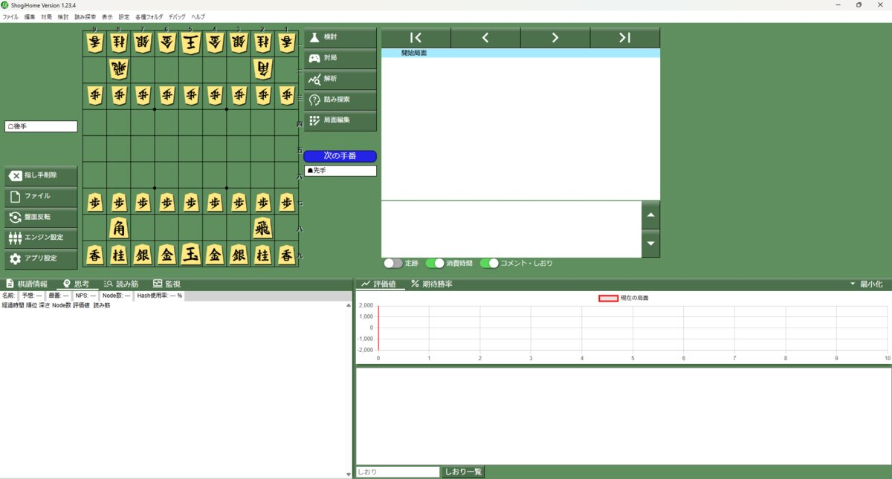

「エンジン管理」の画面で、下の「追加」を押します。

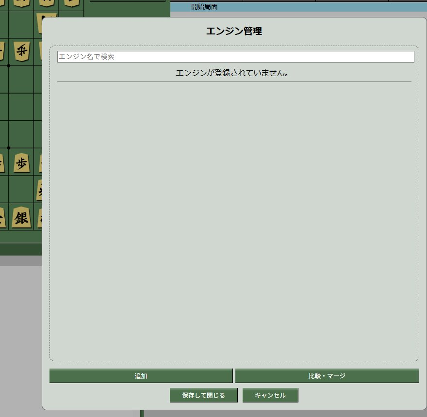

ファイルを選ぶ画面で、展開したフォルダの `rshogi-avx2.exe` を選び、「開く」を押します（Windows の設定によっては、拡張子の付かない `rshogi-avx2` と表示されます）。3 種セットなら、使いたいフォルダ（`1536`・`2304`・`3072`）の中の exe を選びます。

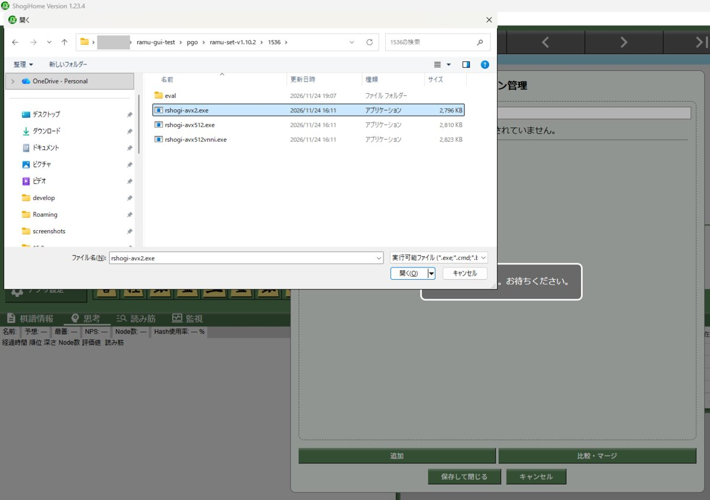

exe は 3 種類あり、使える CPU が違います。

| ファイル                | 使える CPU                                      |
| ----------------------- | ----------------------------------------------- |
| `rshogi-avx2.exe`       | AVX2 に対応した CPU。まずはこれを使ってください |
| `rshogi-avx512.exe`     | AVX-512 に対応した CPU                          |
| `rshogi-avx512vnni.exe` | AVX-512 VNNI に対応した CPU                     |

AVX-512 や AVX-512 VNNI に対応しているかは、同じシリーズの名前でも CPU の型番ごとに違います。使いたい場合は、お使いの CPU の型番をメーカーの仕様のページで調べてください。対応していない版は起動しないか、すぐに止まります。

登録すると、一覧にエンジン名が出ます。

| 商品             | エンジン名                                                    |
| ---------------- | ------------------------------------------------------------- |
| RAMU DR7（単品） | RAMU DR7                                                      |
| 3 種セット       | RAMU mini DR7（1536）、RAMU DR7（2304）、RAMU big DR7（3072） |
| COCO             | COCO                                                          |

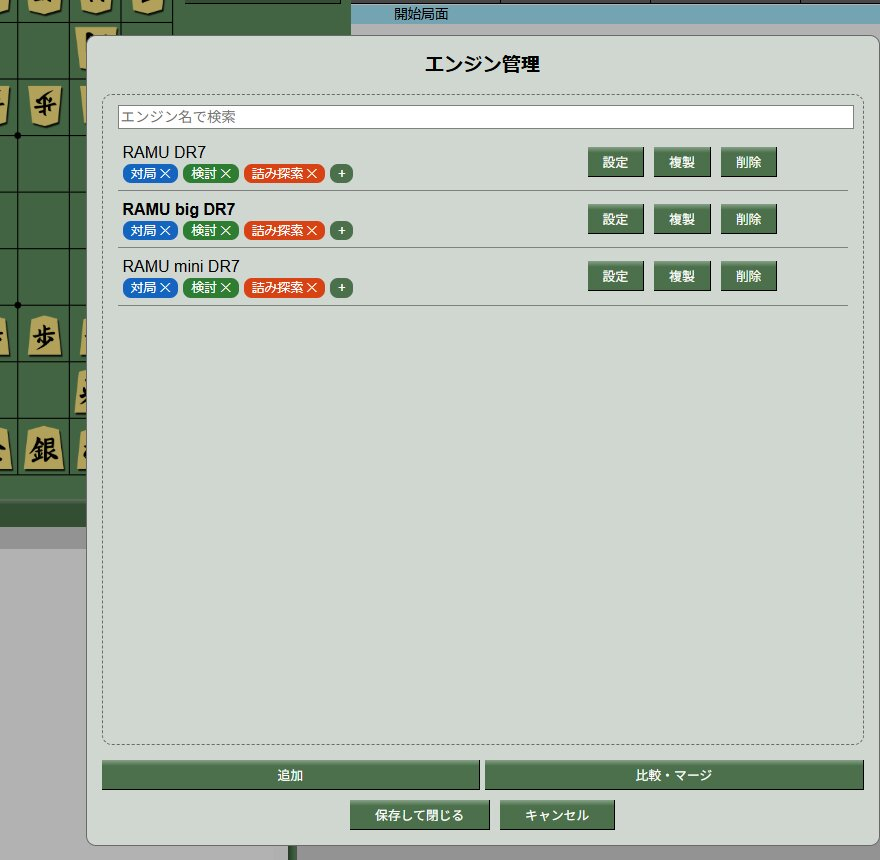

「設定」を押すと、エンジンの設定を変えられます。

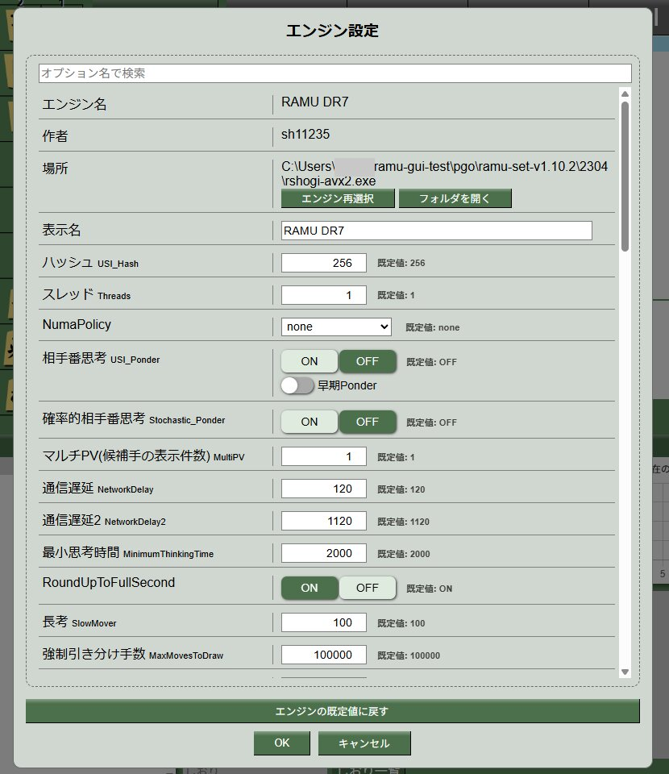

評価関数を読むための設定（EvalFile など）は、同梱の `engine_options.txt` からエンジンが自動で読むので、変える必要はありません。
ほかの設定も、最初は初期値のままで使えます。PC に合わせて変えたい場合は、次の 2 つを目安にしてください。

- Threads: 読みに使うスレッドの数。CPU のスレッド数（論理コア数）程度
- USI_Hash: 読んだ局面を覚えておく領域の大きさ（MB）。搭載メモリの半分くらいまで

設定を変えたら「OK」を押し、エンジン管理の画面に戻って「保存して閉じる」を押します。

## 3. 検討する

盤の右の「検討」を押し、エンジンを選んで「検討開始」を押します。

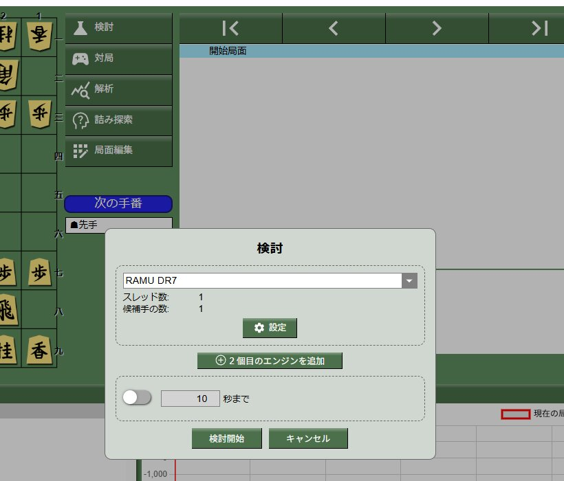

左下の「思考」のタブに、読み筋と評価値が出ます。

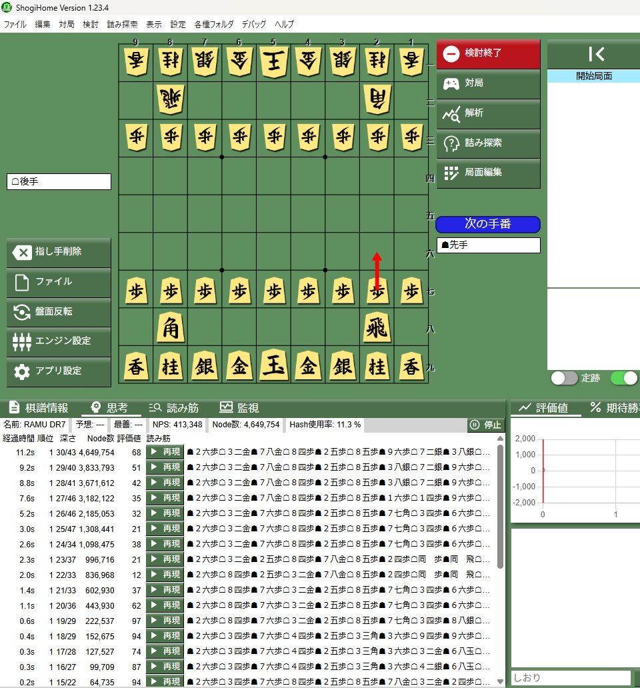

平手の初期局面を検討して、評価値が次の値に近ければ、評価関数を正しく読めています（1 スレッドで深さ 16 まで読んだときの値です。スレッド数や読む深さで少し変わります）。

| エンジン      | 評価値 |
| ------------- | ------ |
| RAMU DR7      | +87    |
| RAMU mini DR7 | +44    |
| RAMU big DR7  | +66    |
| COCO          | +94    |

評価値が数千点に振れるときは、`engine_options.txt` と `eval` フォルダが exe と同じフォルダにあるかを確かめてください。

## 4. 対局する

盤の右の「対局」を押し、「ローカル対局」を選びます。「先手（下手）」と「後手（上手）」のうち、自分が指す側には「人」を、相手の側には登録したエンジンを選び、持ち時間を決めて「対局開始」を押します。両方にエンジンを選ぶと、エンジンどうしの対局になります。

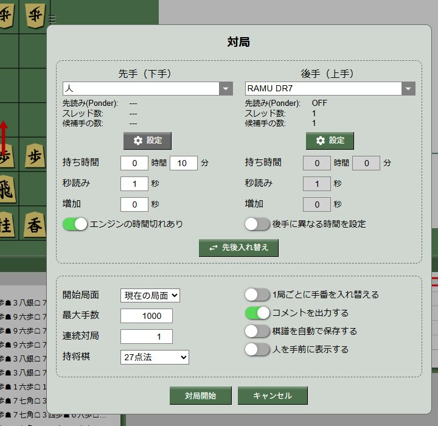

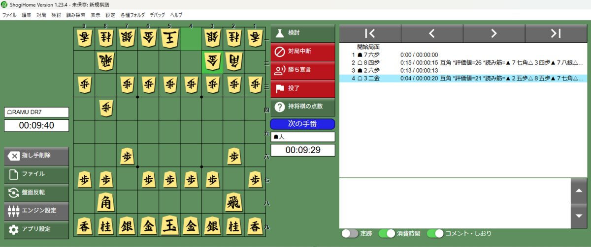

## 起動しないとき

- 登録した exe が起動しない、またはすぐに止まるときは、まず `rshogi-avx2.exe` を登録し直してください。
- `rshogi-avx2.exe` でも起動しないときは、CPU が AVX2 に対応していない可能性があります。推奨動作環境の CPU（Intel 第4世代 Core 以降、AMD Ryzen 以降）かを確かめてください。
- それでも動かないときは、BOOTH の商品ページの「ショップへのお問い合わせ」からご連絡ください。使っている CPU・将棋ソフト・登録した exe の名前を書いていただけると助かります。

## Linux で使う場合

`rshogi-linux-avx2`・`rshogi-linux-avx512`・`rshogi-linux-avx512vnni` が Linux 版です（x86_64、glibc 2.34 以降。Ubuntu 22.04 以降など）。まずは `rshogi-linux-avx2` を使ってください。
展開した後に実行できない場合は、展開したフォルダで実行の権限を付けてから、Linux 版の ShogiHome の「追加」で選んでください。

```
chmod +x rshogi-linux-avx2 rshogi-linux-avx512 rshogi-linux-avx512vnni
```

## COCO をやねうら王で使う場合

COCO の評価関数は、やねうら王の NNUE 版（HalfKP 256x2-32-32）でも読めます。使い方は同梱の README.txt にあります（FV_SCALE を 14 にします）。

## ラム将棋（ブラウザ）で使う場合

評価関数は、ブラウザで遊べる将棋アプリ「[ラム将棋](https://ramu-shogi.sh11235.com/)」に追加して、対局の相手や研究ノートの解析にも使えます。ログインは要りません。追加した評価関数はそのブラウザの中にだけ保存されます。

ラム将棋の上の「AI（評価関数）」を開き、「ファイルを選ぶ」から展開したフォルダの `eval/nn.bin` を選びます。

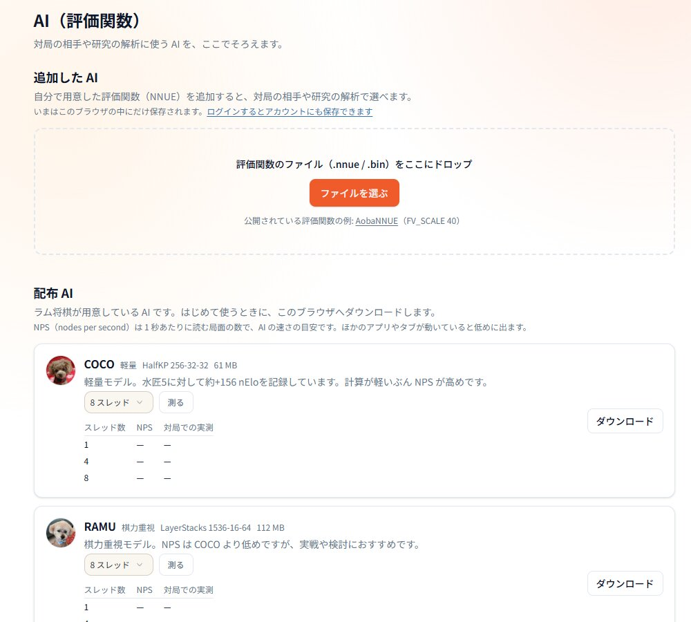

「AI を追加」の画面で次のように入れて、「追加」を押します。

| 欄                         | RAMU DR7（3 種セットの 3 つも同じ）               | COCO                        |
| -------------------------- | ------------------------------------------------- | --------------------------- |
| 表示名                     | 好きな名前（例: RAMU DR7）                        | 好きな名前（例: COCO）      |
| FV_SCALE                   | 14                                                | 14                          |
| LayerStacks の振り分け方式 | Q16 進行度（rshogi / tatara progresskpabsq16、…） | 未設定（HalfKP 等では不要） |
| 進行度バケット数           | 8                                                 | （出ません）                |
| 進行度係数ファイル         | 同じ `eval` フォルダの `progress.bin`             | （出ません）                |

振り分け方式は「f32 進行度」ではなく「Q16 進行度」を選んでください。

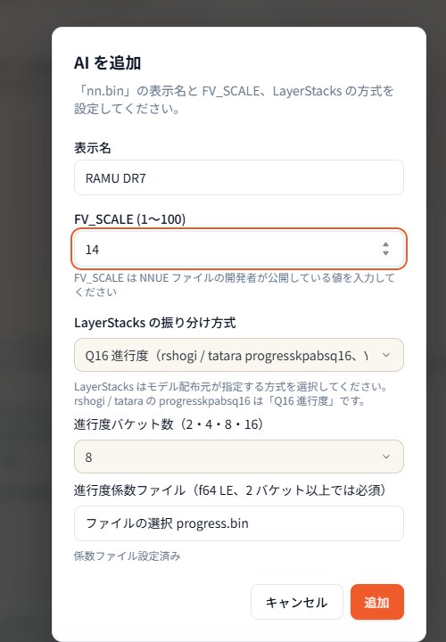

追加すると、「追加した AI」に並びます。

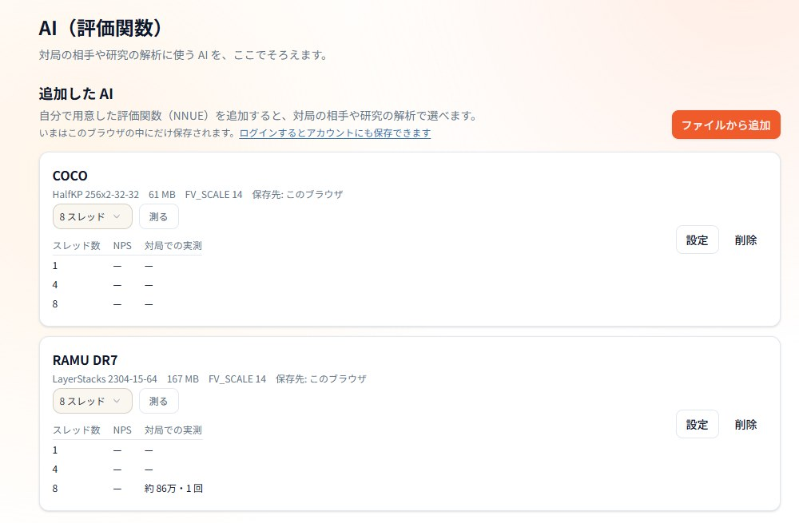

対局するときは、上の「対局」を開き、「相手」で追加した AI の表示名を選んで「対局開始」を押します。

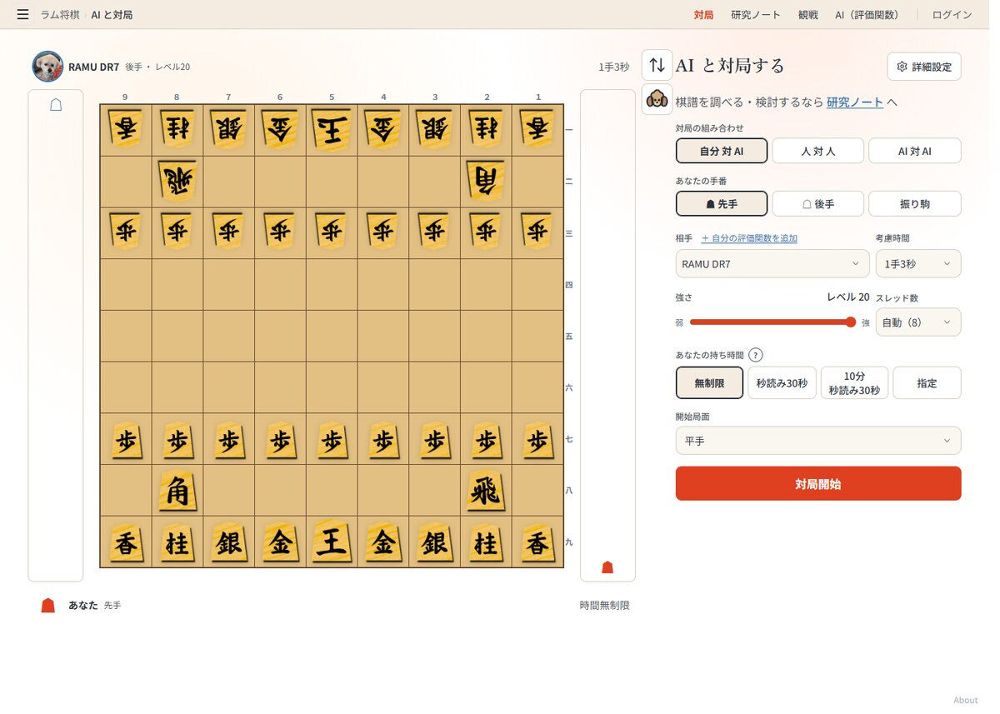

対局の画面には評価値が出ません。評価値を見るときは、上の「研究ノート」で局面を開き、右上の「解析の設定」の「使う AI」で追加した AI を選んで解析します。

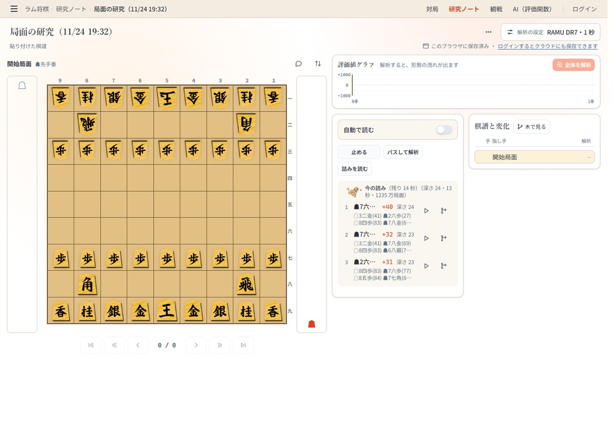
